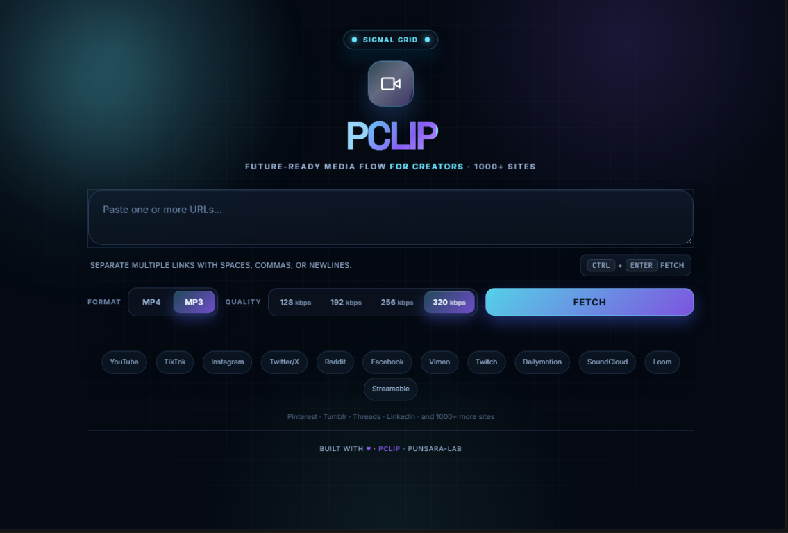

# PClip

> Future-ready media flow for creators.

A sleek, self-hosted downloader built for high-speed media capture from the web. Paste a link, fetch metadata in seconds, choose a format, and download cleanly in MP4 or MP3 — all from a premium dark interface designed for modern creators and power users.




Built by [**punsara-lab**](https://github.com/punsara-lab) · minimal code, maximum utility.

---

## Why PClip

PClip is designed for one job: make media downloading feel fast, focused, and effortless.

- Works with YouTube, TikTok, Instagram, X/Twitter, Reddit, Twitch, Vimeo, SoundCloud, and 1000+ supported sites through `yt-dlp`
- Gives you quick format selection for video and audio
- Handles playlist links without friction
- Keeps the workflow local and private
- Ships with a polished interface that feels like a creator tool, not a broken utility app

This project is intentionally lightweight: no heavy framework, no build pipeline, no database, no clutter.

---

## Features

- 1000+ source support via `yt-dlp`
- MP4 and MP3 output with metadata support
- Audio bitrate selection: 128 / 192 / 256 / 320 kbps
- Resolution selection for supported video sources
- Batch download support for multiple URLs
- Playlist expansion for media collections
- URL deduplication to avoid repeat fetches
- Embedded cover art and ID3 metadata for audio
- Dark-mode, glass-panel interface with future-cyber styling
- Local-first workflow for privacy and control
- Runs on Windows, macOS, Linux, and Docker

---

## Quick start

### Windows

Make sure Python 3.8+ and FFmpeg are installed and available in `PATH`, then run:

```bat
pclip.bat
```

This script creates a virtual environment, installs dependencies, updates `yt-dlp`, and opens the app in your browser.

### macOS / Linux

```bash
# install ffmpeg first
# macOS: brew install ffmpeg
# Ubuntu/Debian: sudo apt install ffmpeg

git clone https://github.com/punsara-lab/pclip.git
cd pclip
./pclip.sh
```

Then open:

```text
http://localhost:8899
```

### Docker

```bash
docker build -t pclip .
docker run -p 8899:8899 -v pclip-downloads:/app/downloads pclip
```

Or with Docker Compose:

```bash
docker compose up -d
```

---

## How to use it

1. Paste one or more URLs into the input box.
2. Choose output type: MP4 video or MP3 audio.
3. Click Fetch to load metadata and thumbnails.
4. Optionally override quality or bitrate per item.
5. Download individually or use Download All for the batch.

Files are saved into the local `downloads/` folder, with MP3s tagged and cover art embedded.

---

## Tech stack

| Layer | Stack |
|---|---|
| Backend | Python 3 + Flask |
| Frontend | Vanilla HTML, CSS, JavaScript |
| Download engine | `yt-dlp` |
| Audio metadata | `mutagen` |
| Media conversion | FFmpeg |
| Deployment | Local runtime + Docker-ready |

Core dependencies:

```txt
flask
yt-dlp
mutagen
```

---

## Environment variables

| Variable | Default | Purpose |
|---|---:|---|
| `PORT` | `8899` | App port |
| `HOST` | `127.0.0.1` | Bind address |
| `PCLIP_AUTO_OPEN` | `1` | Open browser automatically |
| `PCLIP_NO_UPDATE` | unset | Skip `yt-dlp` auto-update on startup |

---

## Project layout

```text
pclip/
├── app.py                  # Flask backend + download logic
├── templates/
│   └── index.html          # UI layout, styles, and browser logic
├── static/
│   └── favicon.svg         # Brand icon
├── downloads/              # Downloaded media output
├── pclip.bat               # Windows launcher
├── pclip.sh                # macOS/Linux launcher
├── Dockerfile
├── docker-compose.yml
├── requirements.txt
├── LICENSE
├── README.md
└── .gitignore
```

---

## Notes

- This tool is intended for personal use and legitimate media access.
- Respect platform terms of service, copyright laws, and local regulations.
- The project is intentionally lightweight and transparent by design.

---

## License

[MIT](LICENSE) · © 2026 [punsara-lab](https://github.com/punsara-lab)
