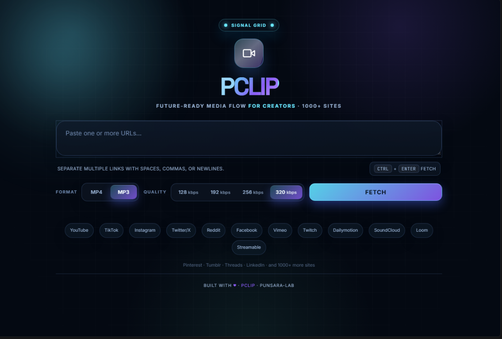

# PClip

> Future-ready media flow for creators.

A sleek, self-hosted downloader built for high-speed media capture from the web. Paste a link, fetch metadata in seconds, choose a format, and download cleanly in MP4 or MP3 — all from a premium dark interface designed for modern creators and power users.




Built by [**punsara-lab**](https://github.com/punsara-lab) · minimal code, maximum utility.

---

## Why PClip

PClip is designed for one job: make media downloading feel fast, focused, and effortless.

- Works with YouTube, TikTok, Instagram, X/Twitter, Reddit, Twitch, Vimeo, SoundCloud, adult sites, and 1000+ supported sites through `yt-dlp`
- Gives you quick format selection for video and audio
- Handles playlist links without friction
- Keeps the workflow local and private
- Accessible from your phone on the same WiFi, or from anywhere via a free Cloudflare tunnel
- Ships with a polished interface that feels like a creator tool, not a broken utility app

This project is intentionally lightweight: no heavy framework, no build pipeline, no database, no clutter.

---

## Features

- 1000+ source support via `yt-dlp`
- MP4 and MP3 output with metadata support
- Audio bitrate selection: 128 / 192 / 256 / 320 kbps
- Resolution selection for supported video sources
- Batch download support for multiple URLs
- Playlist expansion for media collections
- URL deduplication to avoid repeat fetches
- Embedded cover art and ID3 metadata for audio
- Dark-mode, glass-panel interface with future-cyber styling
- Local-first workflow for privacy and control
- Three serve modes: local, same-WiFi (phone access), and anywhere (free Cloudflare tunnel)
- Runs locally on Windows, macOS, and Linux

---

## Quick start

### Windows

Make sure Python 3.8+ and FFmpeg are installed and available in `PATH`, then run:

```bat
pclip.bat
```

This script creates a virtual environment, installs dependencies, updates `yt-dlp`, and opens the app in your browser. The app binds to `0.0.0.0` so it's reachable from your phone on the same WiFi.

The web UI has an **Access panel** at the top with three URLs:

- **local** — `http://localhost:8899` (this PC only)
- **wifi** — your LAN IP (use on your phone/tablet on the same network)
- **anywhere** — click **Enable remote** to start a free Cloudflare tunnel and get a public `https://...trycloudflare.com` URL that works from any device anywhere. (Runs `cloudflared`; if missing, run `pclip-tunnel.bat` once to download it.)

Each URL has a **copy** button.

### macOS / Linux

```bash
# install ffmpeg first
# macOS: brew install ffmpeg
# Ubuntu/Debian: sudo apt install ffmpeg

git clone https://github.com/punsara-lab/pclip.git
cd pclip
./pclip.sh
```

Then open:

```text
http://localhost:8899
```

For phone access on the same network, run with `HOST=0.0.0.0`:

```bash
HOST=0.0.0.0 ./pclip.sh
```

and open the printed LAN URL on your phone.

---

## Serving modes

| Mode | How to access |
|---|---|
| Local only | Open `http://localhost:8899` on this PC |
| Same WiFi | Copy the **wifi** URL from the Access panel, open it on any device on your WiFi |
| Anywhere | Click **Enable remote** in the Access panel → copy the public `https://*.trycloudflare.com` URL |

The **anywhere** tunnel uses a random URL that changes on every restart. For a stable URL, use Tailscale Funnel (free account) or a named Cloudflare tunnel.

---

## Cloud hosting (optional)

PClip can be containerized and hosted for free on Render, Koyeb, or Hugging Face Spaces using the included `Dockerfile` and `render.yaml`.

**Important:** free cloud hosts use datacenter IPs, which **YouTube aggressively blocks**. Non-YouTube sites generally work fine. For reliable YouTube downloads, run PClip locally and use the tunnel option above.

Deploy on Render:

1. Push the repo to GitHub.
2. Render → **New → Blueprint** → select repo → it reads `render.yaml` automatically → **Deploy**.
3. You get a free `https://*.onrender.com` URL.

---

## How to use it

1. Paste one or more URLs into the input box.
2. Choose output type: MP4 video or MP3 audio.
3. Click Fetch to load metadata and thumbnails.
4. Optionally override quality or bitrate per item.
5. Download individually or use Download All for the batch.

Files are saved into the `downloads/` folder, with MP3s tagged and cover art embedded.

---

## Tech stack

| Layer | Stack |
|---|---|
| Backend | Python 3 + Flask |
| Frontend | Vanilla HTML, CSS, JavaScript |
| Download engine | `yt-dlp` |
| Audio metadata | `mutagen` |
| Media conversion | FFmpeg |
| Runtime | Local Flask development server |

Core dependencies:

```txt
flask
yt-dlp
mutagen
```

---

## Environment variables

| Variable | Default | Purpose |
|---|---:|---|
| `PORT` | `8899` | App port |
| `HOST` | `0.0.0.0` | Bind address (`127.0.0.1` for local only) |
| `PCLIP_AUTO_OPEN` | `1` | Open browser automatically on startup |
| `PCLIP_NO_UPDATE` | unset | Skip `yt-dlp` auto-update on startup |

---

## Sites that need login (cookies)

Some sites (e.g. adult platforms, age-gated content) require an authenticated session. Export your browser cookies to a Netscape-format `cookies.txt` file and pass it via the `--cookies` flag. You can add cookie support to `app.py` by appending `--cookies` to the yt-dlp command when a `COOKIES_FILE` env var is set.

---

## Project layout

```text
pclip/
├── app.py                  # Flask backend + download logic
├── templates/
│   └── index.html          # UI layout, styles, and browser logic
├── static/
│   └── favicon.svg         # Brand icon
├── downloads/              # Downloaded media output
├── pclip.bat               # Windows menu launcher (local / WiFi / anywhere)
├── pclip.sh                # macOS/Linux launcher
├── pclip-tunnel.bat        # Windows remote-tunnel launcher
├── pclip-tunnel.ps1        # Cloudflare tunnel script
├── Dockerfile              # Container image for cloud hosting
├── render.yaml             # Render one-click deploy config
├── .dockerignore
├── requirements.txt
├── LICENSE
├── README.md
└── .gitignore
```

---

## Notes

- This tool is intended for personal use and legitimate media access.
- Respect platform terms of service, copyright laws, and local regulations.
- Keep `yt-dlp` updated — site extractors break frequently; `pip install -U yt-dlp` (or re-run `pclip.bat`) usually fixes them.
- The project is intentionally lightweight and transparent by design.

---

## License

[MIT](LICENSE) · © 2026 [punsara-lab](https://github.com/punsara-lab)
